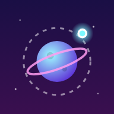

# 🪐 Órbita

Juego arcade de **un solo toque** para móvil y web. Salta de planeta en planeta, recoge estrellas y escapa del vacío que sube sin parar.



## Cómo se juega

- **Toca** la pantalla (o pulsa `Espacio`) para salir disparado de la órbita en línea recta.
- Entra en la órbita de otro planeta para engancharte.
- Apunta al **centro** del planeta para conseguir un **¡PERFECTO!**: sumas puntos extra y encadenas combos (hasta x5).
- Recoge **estrellas ★** y gástalas en la tienda para desbloquear cometas nuevos (Fénix, Ácido, Nebulosa, Dorado y Arcoíris).
- El **vacío** sube cada vez más rápido: no te quedes quieto.
- La dificultad crece: los planetas giran más rápido y son más pequeños, aparecen **asteroides** (a partir de 8 puntos) y **planetas que se mueven** (a partir de 15).

Incluye récord y progreso guardados en el dispositivo, sonido sintetizado, vibración, pausa automática al cambiar de app y soporte del botón «atrás» de Android.

## Estructura

```
www/                 El juego (HTML + CSS + JavaScript, sin dependencias)
  index.html
  style.css
  game.js            Lógica, dibujo, sonido e interfaz
  manifest.json      PWA (instalable desde el navegador)
  sw.js              Service worker (funciona sin conexión)
  icons/
android/             Proyecto Android generado por Capacitor
assets/              Icono y splash de origen para Android
tools/gen-icons.js   Regenera los iconos a partir de www/icons/icon.svg
capacitor.config.json
.github/workflows/   Publicación web y compilación Android automáticas
```

## Probar en local

```bash
npm install
npm start            # abre http://localhost:8080
```

Vale cualquier servidor estático (también puedes abrir `www/index.html` directamente).

## Publicar en la web

### Opción A: GitHub Pages (automático)

1. Fusiona esta rama en `main`.
2. En GitHub: **Settings → Pages → Source: GitHub Actions**.
3. Cada push a `main` publica el juego en `https://<tu-usuario>.github.io/MiPrimerJuego/`.

### Opción B: cualquier hosting

Sube el contenido de la carpeta `www/` a Netlify, Vercel, itch.io (como juego HTML5, en un .zip) o tu propio servidor.

Desde el navegador del móvil se puede **instalar como app** («Añadir a pantalla de inicio»).

## Publicar en Google Play

Requisitos: [Android Studio](https://developer.android.com/studio) y Node.js 20 o superior.

```bash
npm install
npx cap sync android     # copia www/ dentro del proyecto Android
npx cap open android     # abre Android Studio
```

En Android Studio:

1. Prueba en un móvil o emulador con ▶ **Run**.
2. **Build → Generate Signed Bundle / APK → Android App Bundle**.
3. Crea un *keystore* nuevo (guárdalo bien junto con sus contraseñas: lo necesitarás para cada actualización y **no** lo subas al repositorio).
4. Elige `release` y obtendrás `app-release.aab`.

En la [Google Play Console](https://play.google.com/console) (cuota única de 25 $):

1. **Crear app** → nombre «Órbita», tipo *Juego*, gratis.
2. Sube el `.aab` a **Pruebas internas** primero y luego a **Producción**.
3. Completa la ficha: descripción, capturas, icono 512×512 (`www/icons/icon-512.png`), gráfico de funciones 1024×500, clasificación de contenido, política de privacidad (el juego no recoge datos personales; todo se guarda en el dispositivo).

**Para cada actualización**: cambia el juego en `www/`, sube `versionCode` y `versionName` en `android/app/build.gradle`, ejecuta `npx cap sync android` y genera un nuevo `.aab` firmado.

El identificador de la app es `com.javisantana.orbita` (en `capacitor.config.json` y `android/app/build.gradle`). Si quieres cambiarlo, hazlo **antes** de la primera publicación: después ya no se puede.

### APK automático

El workflow `Compilar Android (APK)` compila en GitHub Actions un APK de prueba (instalable directamente en el móvil) y un AAB sin firmar. Lo encontrarás en la pestaña **Actions → último run → Artifacts**.

## Personalizar

- Dificultad, velocidades y cometas: constantes al principio de `www/game.js` (`LAUNCH_SPEED`, `SKINS`, etc.) y la función `addPlanet()`.
- Icono: edita `www/icons/icon.svg` y ejecuta `npm run icons && npm run assets`.
